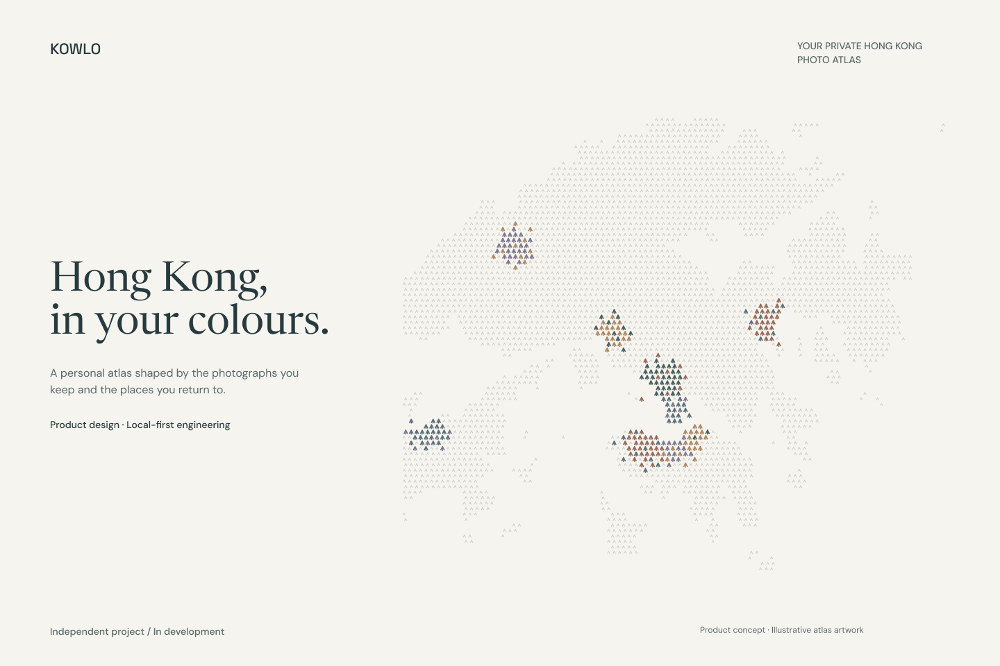
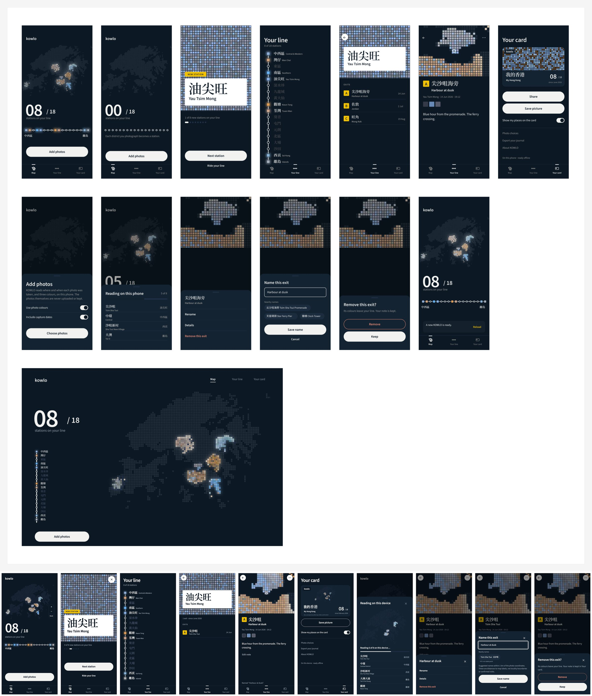

# KOWLO

**Hong Kong, in your colours.**

KOWLO turns the places you photograph into a personal atlas of Hong Kong. Its 18 districts become stations on your own line, with colours drawn from your photographs and places recorded as exits along the way.

**Independent product project · Product design and AI-assisted development · Hyunjun Kim**

## Why I built it

Photographs can preserve a moment without making it easy to revisit the places around it. KOWLO connects photo location data, colours and notes in a journal that people can keep on their own device and export for reuse.

## My contribution

I led product design and AI-assisted development, connecting the atlas concept to geographic data, photo-import workflows and a working local journal. I designed the district and place hierarchy, translated it into user flows, and developed the interaction between photo GPS, district grouping and the visual atlas.

The work also covered on-device photo processing, offline access and export. These features give users a way to revisit and keep their records without making hosted account sync a prerequisite for the journal.

## What the project demonstrates

| Product decision | Implemented contribution | User benefit |
| --- | --- | --- |
| Organize a personal atlas around Hong Kong's 18 districts | District grouping with places nested within each chapter | Revisit a city through a clear structure of districts and individual memories |
| Use each photograph as location and colour evidence | Process GPS and optional colour information on the device | Add places to the atlas without retaining or uploading the original photo in the documented beta workflow |
| Let people keep their own records | Local journal, offline behaviour after initial readiness, and export | Revisit records without a connection and save a reusable copy |
| Make the design inspectable | Product flows, interface examples and implementation evidence | Show how product decisions connect to working behaviour |

## From idea to interface

The core journey connects five steps: import photographs, process location and optional colours on the device, group places into districts, revisit a place and its notes, and export a record or share card. The transit metaphor makes districts and places navigable while the geographic record stays separate from the decorative atlas.

This retained comparison shows the September 2026 Day/Night design generation, with Figma frames above actual application captures. The captures use eight synthetic sample photographs and illustrative places, dates and notes. They demonstrate the product journey rather than a user's private travel history or measured adoption. The board documents an earlier interface; it is not a claim that every screen represents the latest paused build.

## Engineering choices

- **On-device processing:** derive location and optional colours without retaining or uploading the original photograph in the documented browser beta workflow.
- **Geographic integrity:** keep original coordinates and district grouping separate from decorative tiles and suggested place names.
- **Local access and export:** retain a usable journal on the device, support offline access after initial readiness, and let the user keep a reusable copy.
- **Design linked to implementation:** translate the district-to-place hierarchy into import, navigation, notes and record-management flows, then inspect the interface against its design direction.

## Project status

Development and maintenance are paused as of 12 October 2026. The project includes a historical public beta and retained design and implementation evidence. Hosted private sync remains unfinished; individual verification records apply to the versions and behaviours they checked.

This is a product and engineering portfolio project. User adoption, retention and commercial impact have not been measured.

This public repository contains a curated case study and presentation assets. The application source and detailed development history remain in a separate private repository. The retained evidence does not establish physical-device acceptance or completed hosted sync.

[Asset credits and reuse terms](CREDITS.md)

---

Hyunjun Kim · [GitHub](https://github.com/EricEremos) · [LinkedIn](https://linkedin.com/in/ericmos)
