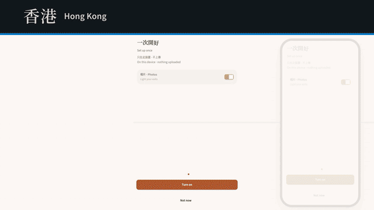
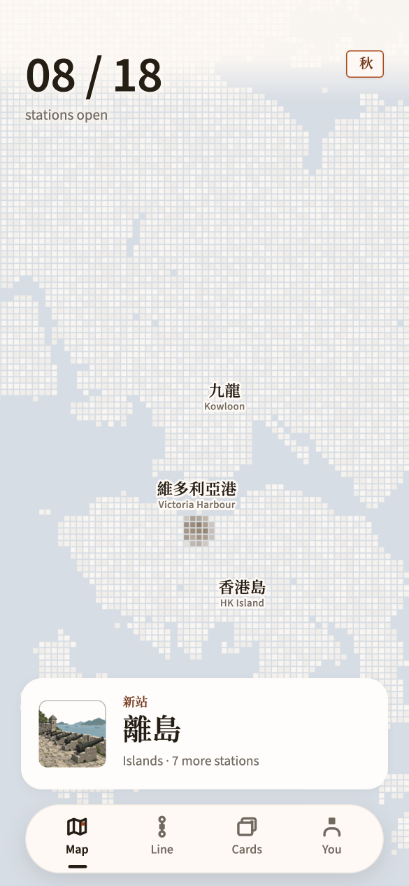
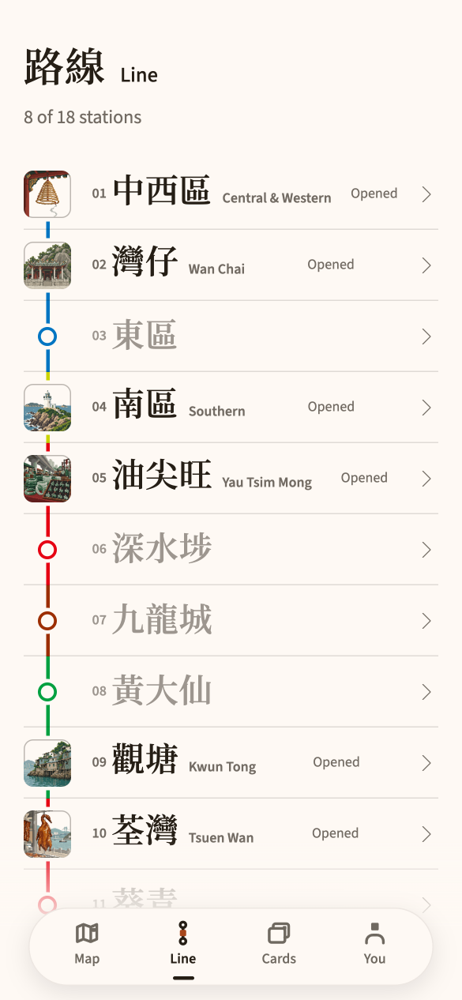
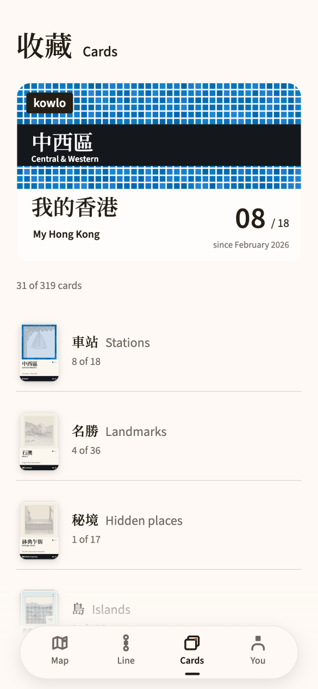
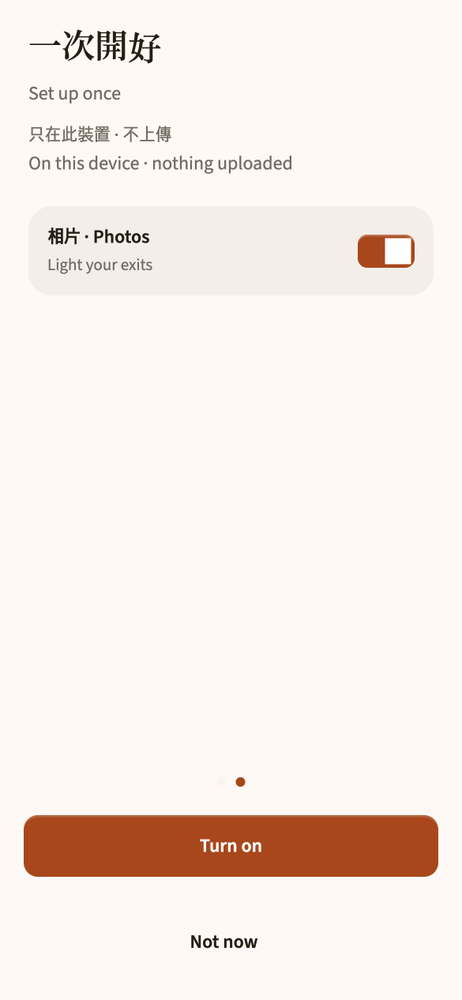
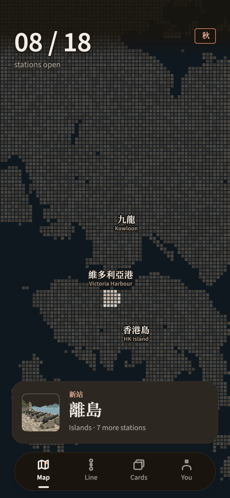

<strong>KOWLO</strong>

<h1 align="center">Your photos. Your Hong Kong.</h1>

A personal photo atlas for the places that stay with you.

<a href="#your-city-in-your-photographs">Explore the atlas</a> · <a href="#why-i-am-making-it">The idea behind KOWLO</a> · <a href="#development-status">Development status</a>

In development. Release 191 (KOWLO 2.0, 10 November 2026) run locally with nothing uploaded; the photographs are the project's eight synthetic sample photos. The loop shows the ride; the MP4 has the full 30-second film with the app's own opening. <a href="assets/kowlo-promo-20261114.mp4">Watch the full film</a> · <a href="assets/kowlo-promo-20261114-poster.png">Still frame</a> · <a href="assets/kowlo-promo-20261114-manifest.json">Capture details</a>

## Your city, in your photographs

A corner you noticed on the way home. A familiar street in a different light. KOWLO keeps the photograph with the place, so the city becomes more than a collection of pins—and the memory is easier to return to than a picture lost in your camera roll.

  
  
  

Actual release-191 screens, 14 November 2026, after adding the project's eight synthetic sample photographs. Places, counts and dates are demonstration data.

### Put the photograph back in its place.

See your photographs across the map, then move between the atlas, your line through the city, walks and your collection. The places you keep give the map its character.

### See your Hong Kong take shape.

KOWLO 2.0 opens on the **Map**: the count of stations open, the newest station, and your line running along the foot of the map. **Line** lists all eighteen stations, **Cards** carries your line on one transit card beside a collection of stations, landmarks, hidden places and islands, and **You** keeps your photos, notes and choices.

  
  

Setup runs once, on the phone. The same map by night (the app's Look set to Dark).

### Leave room for the way back.

The approved **Walk** design starts with a place and a time budget. Choose a saved place, your current location or a point on the map, then review an estimated whole-walk budget that includes the return trip.

[Explore the Walk design](assets/kowlo-walk-campaign-20261022.png) · [Time-budget screen](assets/walk-budget-20261022.png) · [Starting-point picker](assets/walk-start-20261022.png)

*Design previews, 22 October 2026, with sample places and timing and background map tiles disabled. These show the intended experience, rather than a verified walking route.*

## Why I am making it

Hong Kong is easy to move through quickly. I wanted a reason to notice it: the colour of a street, a station sign, a small place worth remembering. KOWLO brings photographs, places and notes together around that idea. Walking and collecting give you another reason to look again.

That purpose shapes the details: bilingual place names, district structure, day and night palettes, illustrated cards, and the less visible work of location handling, local storage and offline behaviour.

## My work

**An independent product by Eric (Hyunjun Kim).** I carry KOWLO from research and product direction through interface design, AI-assisted engineering, testing, release preparation and its public presentation. The same question guides each stage: does this help someone notice and keep something of their city?

## Development status

**In development.** The film and screens shown here come from **release 191** (KOWLO 2.0, 10 November 2026), run locally on 14 November 2026. A public download will be linked here when available.

<strong>Capture details, engineering notes and earlier versions</strong>

The release-191 screens are unretouched captures at an exact half-size reduction. Their photographs are the project's synthetic sample photos, and the places, dates and totals that follow from them are demonstration data, not a personal travel record or customer statistics. The Walk images are separately labelled approved designs.

The implementation combines a modular web interface, IndexedDB-backed local data, offline behaviour and native-wrapper work. Geographic and data checks support the atlas; they do not replace navigation or physical-device testing. Implementation and personal records remain private.

[Read the retained engineering evidence](docs/engineering-evidence.md) for the scope of earlier geographic, database and journal-export checks.

Earlier product generations remain available for context:

- [23 October release-144 photo atlas](assets/photo-atlas-release144-20261023.png), [Your Hong Kong](assets/your-hong-kong-release144-20261023.png) and [collection](assets/collection-release144-20261023.png), with their [campaign cards](assets/kowlo-figma-01-final-20261023.png)
- [22 October illustrated island-card design](assets/card-lantau-20261022.png)
- [September photo-atlas interface](assets/app-atlas-night.jpg)
- [Earlier district view](assets/app-district.jpg)
- [Earlier saved-place view](assets/app-place.jpg)
- [Earlier walking interface](assets/walk-light.png)
- [Original portfolio cover](assets/portfolio-cover.png)
- [Earlier design/application comparison](assets/interface-evidence.jpg)

These are historical references, not the current interface.

---

[Explore more of my work](https://github.com/EricEremos) · [LinkedIn](https://www.linkedin.com/in/ericmos/) · [Credits and reuse](CREDITS.md)
