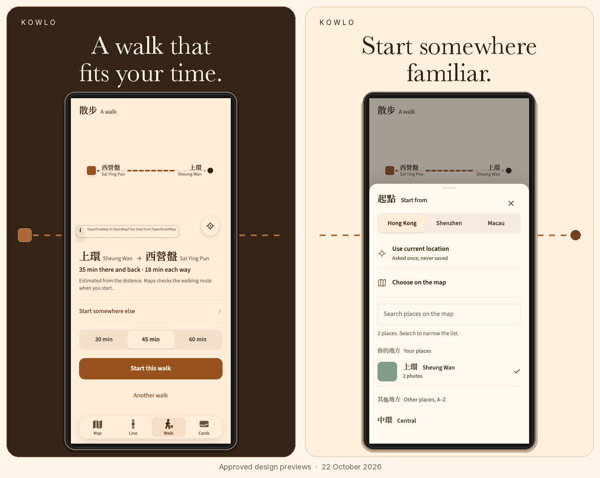
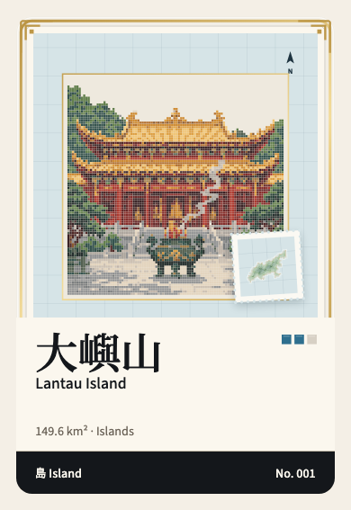

# KOWLO

## Hong Kong, in your colours.

A personal atlas of the places you remember. Keep a photograph with its place, discover the city's character through collectible cards, and find a walk that leaves time to come back.

**Keep a place. Discover a card. Take a walk.**

  

*Approved design previews · 22 October 2026. Original interface captures, with sample places and timing. In development.*

[Explore the time-budget screen](assets/walk-budget-20261022.png) · [Explore the starting-point picker](assets/walk-start-20261022.png)

Created by **Eric (Hyunjun Kim)** · Product direction, design, AI-assisted engineering and release preparation

### A collection with a sense of place.

Hong Kong's places, landmarks and city details become a collection. Illustrated fronts, a paper name panel and a consistent information band give each card its own identity within the same system.

  

*Approved collectible-card design preview · 22 October 2026. One example from the ten-family card design system.*

### A walk with room to come back.

Choose where to start, then choose how much time you have. KOWLO suggests a destination within a **whole-walk budget: there and back**. Your saved places appear first in the starting-point picker; other places follow alphabetically. The interface also offers starting from your current location or a point on the map.

| Start somewhere that matters | Know what the time means | Continue with Maps |
| :--- | :--- | :--- |
| Begin from a saved place, your current location or the map. | Review an estimated return trip before choosing the walk. | Maps checks the walking route when you start. |

*Approved Walk design previews · 22 October 2026, using sample places and timing. These previews show the intended interface; they are not a demonstration of released functionality. Map tiles are disabled. Walking times are estimates; the interface indicates that Maps checks the route when a walk begins.*

### Why I am making it.

A street you return to. A colour you notice on the way home. A small corner that would otherwise disappear into your camera roll. KOWLO brings photographs, places and notes together so you can return to the memory as well as the location. Walking and collecting give you another reason to look at the city.

The district structure, bilingual place names, day and night palettes and illustrated cards all serve that idea. The work reaches beyond the screens into location handling, local storage, offline behaviour and the checks needed before a release.

### From the first question to the finished detail.

KOWLO is my independent product project. I shape the brief, design the experience, build and test the implementation, and prepare its releases and public presentation. AI supports that full cycle: I use **ChatGPT for research, planning and building**, and **Claude for design refinement and finishing**. I review the work against the product's purpose and decide what changes next.

### Current status

**In development · design preview: 22 October 2026.** These screens show the newer approved Walk and collectible-card work. A public download will be linked here when available; implementation and personal records remain private.

<strong>Engineering notes and earlier product evidence</strong>

The implementation combines a modular web interface, IndexedDB-backed local data, offline behaviour and native-wrapper work. Geographic and data checks support the atlas; they do not replace navigation or physical-device testing.

[Read the retained engineering evidence](docs/engineering-evidence.md) for the scope of earlier geographic, database and journal-export checks.

Earlier product generations remain available for context:

- [September photo-atlas interface](assets/app-atlas-night.jpg)
- [Earlier district view](assets/app-district.jpg)
- [Earlier saved-place view](assets/app-place.jpg)
- [Earlier walking interface](assets/walk-light.png)
- [Original portfolio cover](assets/portfolio-cover.png)
- [Earlier design/application comparison](assets/interface-evidence.jpg)

These are historical references, not the current interface.

---

[More of my work](https://github.com/EricEremos) · [LinkedIn](https://www.linkedin.com/in/ericmos/) · [Credits and reuse](CREDITS.md)
