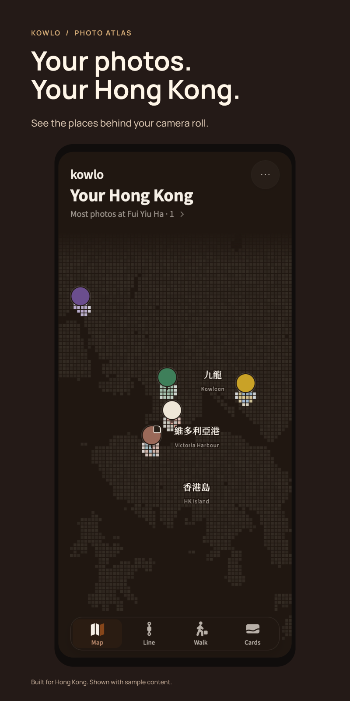
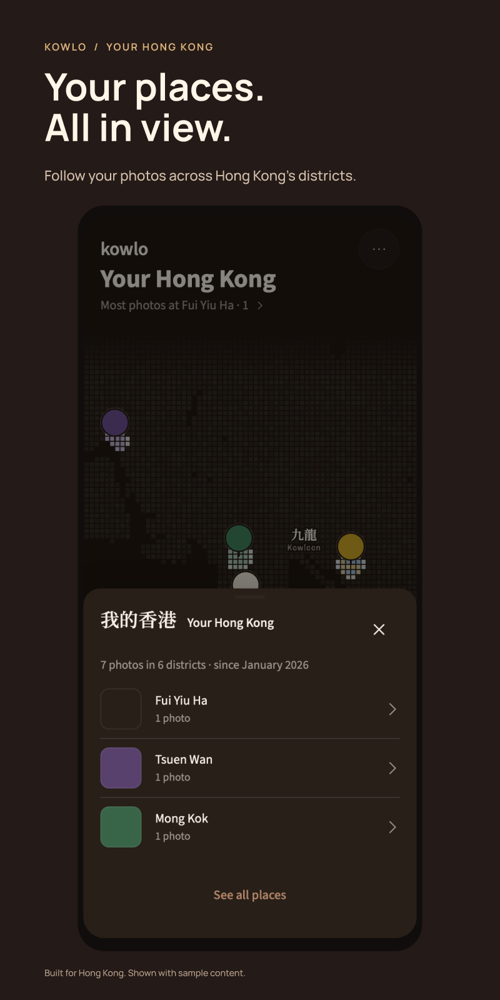
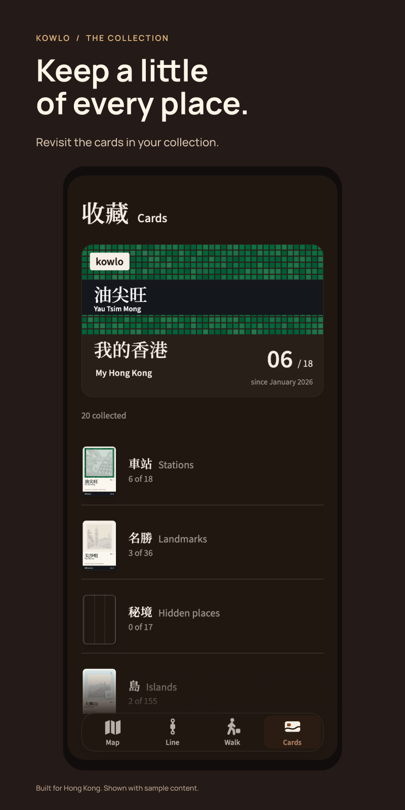

<strong>KOWLO</strong>

<h1 align="center">Your photos. Your Hong Kong.</h1>

A personal photo atlas for the places that stay with you.

<a href="#your-city-in-your-photographs">Explore the atlas</a> · <a href="#why-i-am-making-it">The idea behind KOWLO</a> · <a href="#development-status">Development status</a>

  

Actual development interface · release-144 audit, 23 October 2026 · Sample photographs and places. Select a campaign card to see its original screen.

## Your city, in your photographs

A corner you noticed on the way home. A familiar street in a different light. KOWLO keeps the photograph with the place, so the city becomes more than a collection of pins—and the memory is easier to return to than a picture lost in your camera roll.

### Put the photograph back in its place.

See your photographs across the map, then move between the atlas, your line through the city, walks and your collection. The places you keep give the map its character.

### See your Hong Kong take shape.

Open **Your Hong Kong** to bring your photographs, districts and place list into one view. Then turn to **Cards**, where illustrated stations, landmarks, hidden places and islands give the city's details a collection of their own.

  
  

The photographs, dates, totals and collection progress above are demonstration data.

### Leave room for the way back.

The approved **Walk** design starts with a place and a time budget. Choose a saved place, your current location or a point on the map, then review an estimated whole-walk budget that includes the return trip.

[Explore the Walk design](assets/kowlo-walk-campaign-20261022.png) · [Time-budget screen](assets/walk-budget-20261022.png) · [Starting-point picker](assets/walk-start-20261022.png)

*Design previews, 22 October 2026, with sample places and timing and background map tiles disabled. These show the intended experience, rather than a verified walking route.*

## Why I am making it

Hong Kong is easy to move through quickly. I wanted a reason to notice it: the colour of a street, a station sign, a small place worth remembering. KOWLO brings photographs, places and notes together around that idea. Walking and collecting give you another reason to look again.

That purpose shapes the details: bilingual place names, district structure, day and night palettes, illustrated cards, and the less visible work of location handling, local storage and offline behaviour.

## My work

**An independent product by Eric (Hyunjun Kim).** I carry KOWLO from research and product direction through interface design, AI-assisted engineering, testing, release preparation and its public presentation. The same question guides each stage: does this help someone notice and keep something of their city?

## Development status

**In development.** The atlas, personal summary and collection shown here come from the release-144 audit on **23 October 2026**. A public download will be linked here when available.

<strong>Capture details, engineering notes and earlier versions</strong>

The three campaign cards use original, unretouched application interfaces. Supporting artwork and lettering sit outside the screens. Their photographs, dates and totals belong to a demonstration fixture, not a personal travel record or customer statistics. The Walk images are separately labelled approved designs.

The implementation combines a modular web interface, IndexedDB-backed local data, offline behaviour and native-wrapper work. Geographic and data checks support the atlas; they do not replace navigation or physical-device testing. Implementation and personal records remain private.

[Read the retained engineering evidence](docs/engineering-evidence.md) for the scope of earlier geographic, database and journal-export checks.

Earlier product generations remain available for context:

- [22 October illustrated island-card design](assets/card-lantau-20261022.png)
- [September photo-atlas interface](assets/app-atlas-night.jpg)
- [Earlier district view](assets/app-district.jpg)
- [Earlier saved-place view](assets/app-place.jpg)
- [Earlier walking interface](assets/walk-light.png)
- [Original portfolio cover](assets/portfolio-cover.png)
- [Earlier design/application comparison](assets/interface-evidence.jpg)

These are historical references, not the current interface.

---

[Explore more of my work](https://github.com/EricEremos) · [LinkedIn](https://www.linkedin.com/in/ericmos/) · [Credits and reuse](CREDITS.md)
