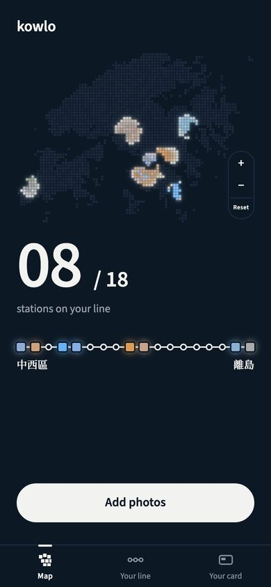
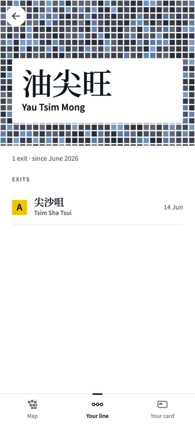
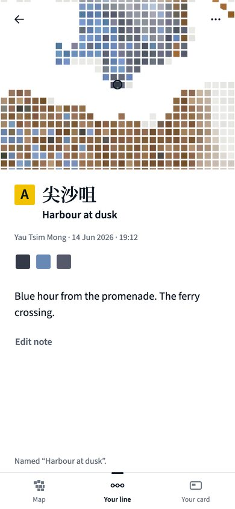
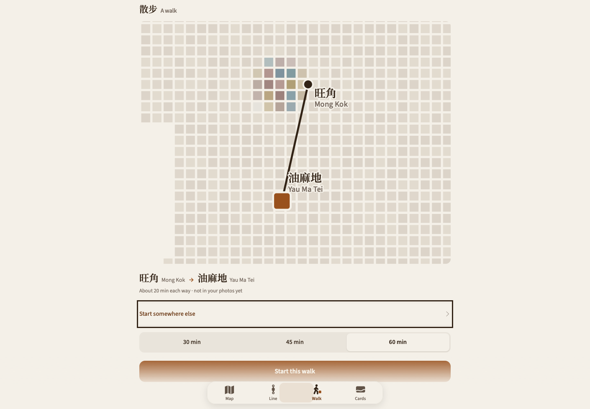

# KOWLO

## Hong Kong, in your colours.

A personal atlas of the places you remember. Keep a photograph with its place, watch your Hong Kong take shape, and find a reason to go outside again.

**Keep a place. Follow a memory. Take a walk.**

Built by **Eric (Hyunjun Kim)** · Independent product design and AI-assisted development

  
  
  

*Actual September 2026 browser-app captures using eight synthetic sample photographs. Places, dates and notes are illustrative. These show an earlier version of the atlas, rather than the current development interface.*

### Your city becomes a collection of places that mean something.

A street you return to. A colour you noticed on the way home. A small corner that would otherwise disappear into your camera roll. KOWLO brings photographs, places and notes together so you can return to the memory as well as the location.

| Keep | Explore | Return |
| :--- | :--- | :--- |
| Save a photograph with a place and a note. | See your collection across Hong Kong's districts. | Open a place again, or make it the start of a walk. |

### A walk with room to come back.

The current development version adds a personal walking flow: choose a starting point, set the time you have and explore nearby places. The time represents the **whole walk there and back**. A destination is suggested with room for the return journey.

  

*Actual October development capture, taken before release 142. The current release has further changes to walking-time guidance, loading and presentation. The screenshot is retained as visual evidence of the product in development, rather than presented as an exact capture of release 142.*

### Designed around Hong Kong, built around personal memory.

The district structure, station-inspired lettering, day and night palettes, and photo colours give the atlas its character. The product work runs from navigation and interface design through location handling, local storage and the details that make a place feel worth keeping.

My work includes product direction, interface and interaction design, implementation, testing and release preparation. AI assists the work; I set the direction, review what is built and decide what needs to change.

### Current status

**In active development · release-142 handoff dated 22 October 2026.** Recent work refines the introduction, photo-pin contrast, place-name presentation, return-walk guidance and map-loading behaviour. The release handoff records a passing release gate and deployment; that is the project's recorded result, rather than a new independent test performed for this showcase.

KOWLO is a working product under development. A public App Store release, adoption figures and complete acceptance across physical devices are not claimed here. Implementation remains private.

<strong>Engineering notes and earlier evidence</strong>

The implementation combines a modular web interface, IndexedDB-backed local data, offline behaviour and native-wrapper work. Geographic and data checks support the atlas; they do not establish public adoption or replace device testing.

[Read the retained engineering evidence](docs/engineering-evidence.md) for the scope of earlier geographic, database and journal-export checks.

Earlier design and engineering evidence is retained in this repository:

- [Original portfolio cover](assets/portfolio-cover.png)
- [Interface evidence](assets/interface-evidence.jpg)

---

[More of my work](https://github.com/EricEremos) · [LinkedIn](https://www.linkedin.com/in/ericmos/) · [Credits and reuse](CREDITS.md)
