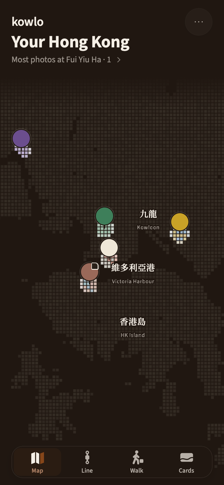
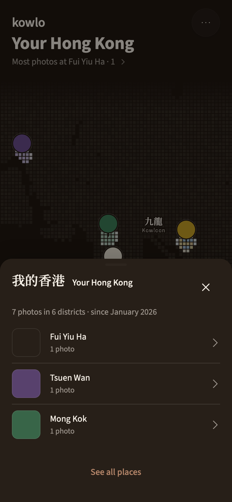
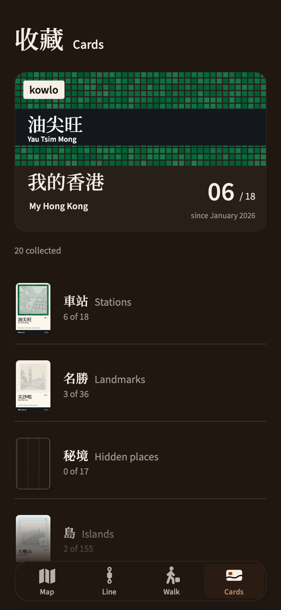

# KOWLO

## Your photos. Your Hong Kong.

A personal photo atlas for the city you know—and the corners you are still discovering. Keep photographs with their places, see your Hong Kong take shape, and collect the details that make it yours.

### Your photographs give the map its colour.

An overview of your places, shaped by the photographs you keep. Move between the map, your line through the city, walks and your collection.

  

*Actual development capture · release-144 audit, 23 October 2026. Sample places and photographs; not a personal travel record.*

### See the places you keep returning to.

Open **Your Hong Kong** for a view of your photographs and districts. The place list gives familiar corners a place in the bigger picture.

  

*Actual development capture · release-144 audit, 23 October 2026. The photographs, dates and totals belong to a demonstration fixture; they are not usage or customer statistics.*

### A collection with a sense of place.

Stations, landmarks, hidden places and islands become a collection. Illustrated cards and bilingual place names give Hong Kong's everyday details room to be noticed.

  

*Actual development capture · release-144 audit, 23 October 2026. Collection progress is sample data. All three interface captures above are published without retouching.*

### A walk with room to come back.

Choose a starting point and a time budget. The approved Walk design makes the **return trip** part of the decision, with saved places close at hand.

**Start somewhere familiar.** Choose a saved place, your current location or a point on the map.

**Know what the time means.** Review the estimated whole-walk budget before choosing a destination.

[View the Walk design](assets/kowlo-walk-campaign-20261022.png) · [Time-budget screen](assets/walk-budget-20261022.png) · [Starting-point picker](assets/walk-start-20261022.png)

*Approved design previews · 22 October 2026. These use sample places and timing, with background map tiles disabled. They show the intended interface, not a verified walking route or public release.*

### Why I am making it.

A street you return to. A colour you notice on the way home. A small corner that would otherwise disappear into your camera roll. KOWLO brings photographs, places and notes together so you can return to the memory as well as the location. Walking and collecting give you another reason to look at the city.

The district structure, bilingual place names, day and night palettes and illustrated cards all serve that idea. The work reaches beyond the screens into location handling, local storage, offline behaviour and the checks needed before a release.

### From the first question to the finished detail.

Created by **Eric (Hyunjun Kim)** · Product direction, design, AI-assisted engineering and release preparation.

KOWLO is my independent product project. I shape the brief, design the experience, build and test the implementation, and prepare its releases and public presentation. AI supports that full cycle: I use **ChatGPT for research, planning and building**, and **Claude for design refinement and finishing**. I review the work against the product's purpose and decide what changes next.

### Current status

**In development · current product evidence: release-144 audit, 23 October 2026.** This page now leads with the photo atlas, personal summary and collection from that audit. A public download will be linked here when available; implementation and personal records remain private.

<strong>Engineering notes and earlier product evidence</strong>

The implementation combines a modular web interface, IndexedDB-backed local data, offline behaviour and native-wrapper work. Geographic and data checks support the atlas; they do not replace navigation or physical-device testing.

[Read the retained engineering evidence](docs/engineering-evidence.md) for the scope of earlier geographic, database and journal-export checks.

Earlier product generations and design reviews remain available for context:

- [22 October illustrated island-card design](assets/card-lantau-20261022.png)
- [September photo-atlas interface](assets/app-atlas-night.jpg)
- [Earlier district view](assets/app-district.jpg)
- [Earlier saved-place view](assets/app-place.jpg)
- [Earlier walking interface](assets/walk-light.png)
- [Original portfolio cover](assets/portfolio-cover.png)
- [Earlier design/application comparison](assets/interface-evidence.jpg)

These are historical references, not the current interface.

---

[More of my work](https://github.com/EricEremos) · [LinkedIn](https://www.linkedin.com/in/ericmos/) · [Credits and reuse](CREDITS.md)
